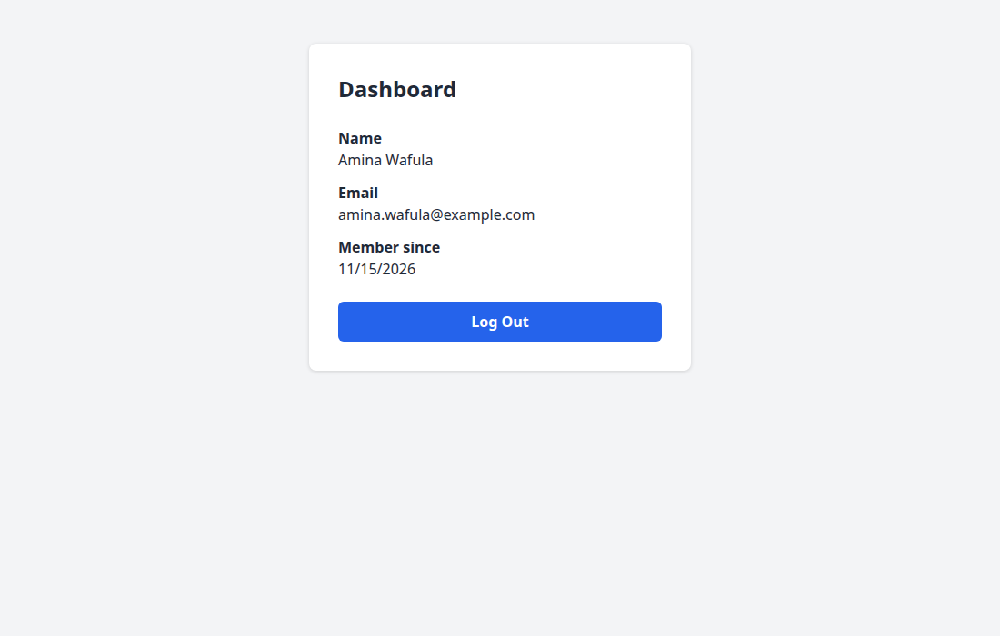
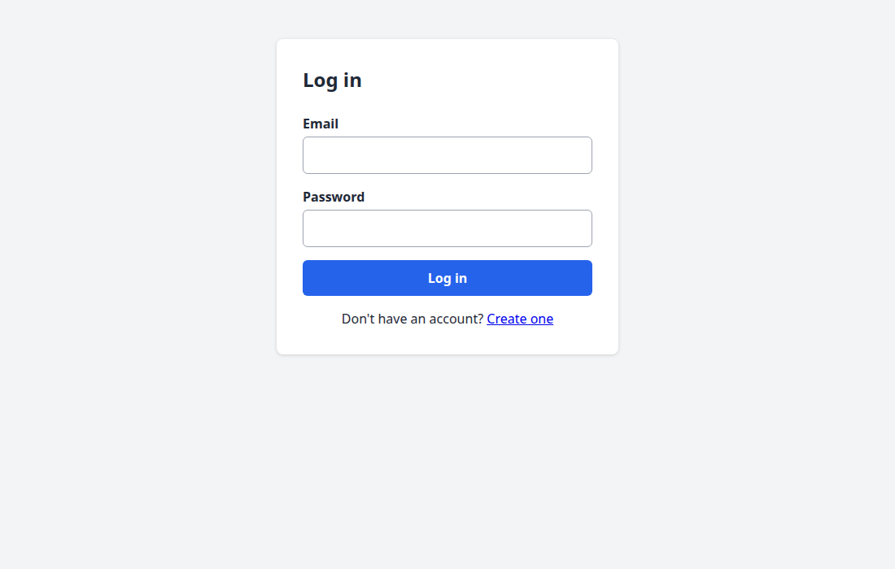

# JWT Auth Starter: Full-Stack Login with React and Express

A full-stack sign-up and login system built with an Express API and a React frontend. Users can create an account, log in, stay logged in after refreshing the page, and open a private dashboard that only works with a valid JSON Web Token (JWT).

It covers the parts of authentication most apps need: safe password storage with bcrypt, signed tokens that expire, a protected API route, and a frontend that guards private pages and logs the user out when their token is no longer valid.

## Live URL

Local development only. The app is not deployed.

## Screenshots

**Dashboard (after logging in)**



**Login page**



## Features

- Register with name, email and password. The password needs at least 8 characters, one uppercase letter and one number.
- Form validation on both the frontend (instant feedback under each field) and the backend (never trusts the client)
- Passwords are hashed with bcrypt (10 salt rounds). Plain-text passwords are never stored.
- Login returns a signed JWT that expires after 1 hour
- `ProtectedRoute` sends logged-out users, or users whose token has expired, back to `/login`
- The session survives a page refresh. The saved token is checked against `GET /api/auth/me` when the app loads.
- Duplicate emails are rejected with `409 Conflict`. Emails are compared in lowercase.
- Every error, including broken JSON, comes back in the same `{ "error": "..." }` shape

## Tech Stack

- **Frontend:** React 19, React Router 7, Vite 8, the Fetch API, Context API for auth state
- **Backend:** Node.js 20+, Express 5, jsonwebtoken, bcryptjs, cors, dotenv
- **Database:** None. Users are kept in an in-memory array (see [Limitations](#limitations)).
- **Deployment:** Not deployed. Runs locally on ports 4000 (API) and 5173 (frontend).

## Project Structure

```
week-7-day-3-backend/
├── server.js                  Express API: register, login, me, error handler
├── .env.example               Environment variables template
├── screenshots/               Images used in this README
└── week-7-day-3-frontend/     React app (Vite)
    └── src/
        ├── App.jsx            Routes: /login, /register, /dashboard
        ├── context/
        │   └── AuthContext.jsx   login(), register(), logout(), restores session on load
        └── components/
            ├── LoginForm.jsx
            ├── RegisterForm.jsx
            ├── ProtectedRoute.jsx  Redirects to /login when there is no valid token
            └── Dashboard.jsx       Shows name, email and "member since"
```

## How to Run Locally

You need **Node.js 20 or newer** and **two terminal windows**.

### 1. Clone the repository

```bash
git clone https://github.com/Abdisamad6378/week-7-day-3-backend.git
cd week-7-day-3-backend
```

### 2. Set up and start the backend (terminal 1)

```bash
npm install
cp .env.example .env
```

Open `.env` and set `JWT_SECRET` to your own random string of at least 32 characters. You can generate one with:

```bash
node -e "console.log(require('crypto').randomBytes(32).toString('hex'))"
```

Then start the API:

```bash
npm run dev
```

You should see `API listening on http://localhost:4000`. There is no database, so there are no migrations to run.

### 3. Set up and start the frontend (terminal 2)

```bash
cd week-7-day-3-frontend
npm install
npm run dev
```

### 4. Open the app

Go to **http://localhost:5173**, click **Create one** to register, then log in to see the dashboard.

> Keep the default ports. The frontend calls `http://localhost:4000`, and the API only accepts requests (CORS) from `http://localhost:5173`.

## Environment Variables

| Variable | Required | Default | Description |
|---|---|---|---|
| `JWT_SECRET` | Yes | none | Secret key used to sign and verify tokens. The server refuses to start without it. |
| `PORT` | No | `4000` | Port the API listens on |

## API Documentation

Base URL: `http://localhost:4000`

| Method | Endpoint | Description | Auth Required |
|---|---|---|---|
| POST | `/api/auth/register` | Create an account. Body: `{ name, email, password }`. Returns `201` with `{ token, user }`. | No |
| POST | `/api/auth/login` | Log in. Body: `{ email, password }`. Returns `200` with `{ token, user }`. | No |
| GET | `/api/auth/me` | Get the logged-in user's profile. Returns `200` with `{ user }`. | Yes (`Authorization: Bearer <token>`) |

### Error responses

| Status | When |
|---|---|
| `400 Bad Request` | Name, email or password fails validation, or the body is not valid JSON |
| `401 Unauthorized` | Wrong email or password, or a missing, invalid or expired token |
| `409 Conflict` | An account with that email already exists |
| `500 Internal Server Error` | Unexpected server error (details are logged, not sent to the client) |

### Example requests

```bash
# Register
curl -X POST http://localhost:4000/api/auth/register \
  -H "Content-Type: application/json" \
  -d '{"name":"Amina Wafula","email":"amina@example.com","password":"Password123"}'

# Log in (copy the token from the response)
curl -X POST http://localhost:4000/api/auth/login \
  -H "Content-Type: application/json" \
  -d '{"email":"amina@example.com","password":"Password123"}'

# Get the current user
curl http://localhost:4000/api/auth/me \
  -H "Authorization: Bearer <paste-token-here>"
```

The `user` object never includes the password hash. A response from `/api/auth/me` looks like this:

```json
{
  "user": {
    "id": "0f8e4b52-6c1d-4e0a-9b7f-2d3c4a5b6e7f",
    "name": "Amina Wafula",
    "email": "amina@example.com",
    "createdAt": "2026-11-15T11:20:00.000Z"
  }
}
```

## Limitations

- **Users are stored in memory.** Restarting the backend deletes every account, and any saved token stops working. You'll need to register again. A real version would use PostgreSQL with Prisma.
- **Tokens are kept in `localStorage`**, as the assignment asked. Any script running on the page can read it, so a production app would usually use an `httpOnly` cookie.
- **There is no refresh token.** After 1 hour the user is sent back to the login page.

## Author

**Abdisamad**

- GitHub: [@Abdisamad6378](https://github.com/Abdisamad6378)
